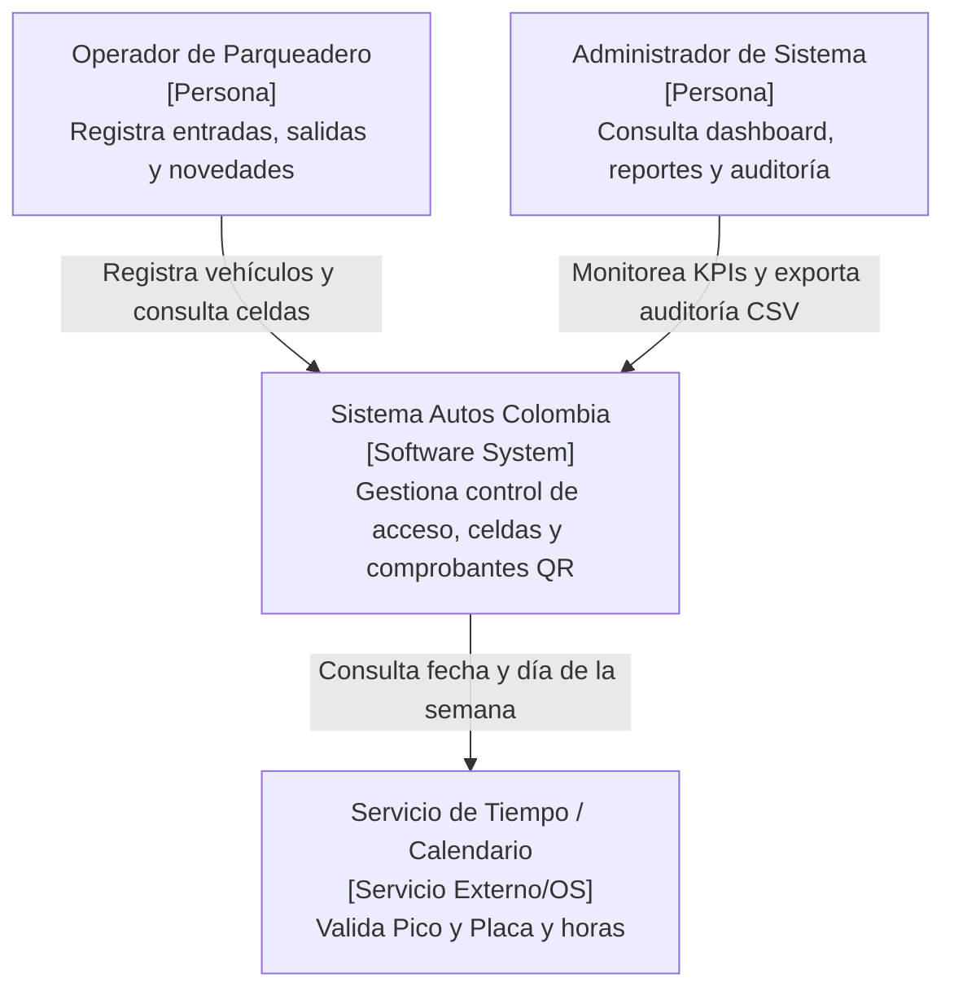
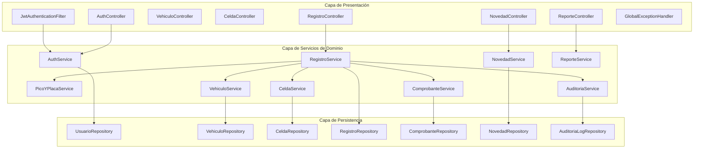
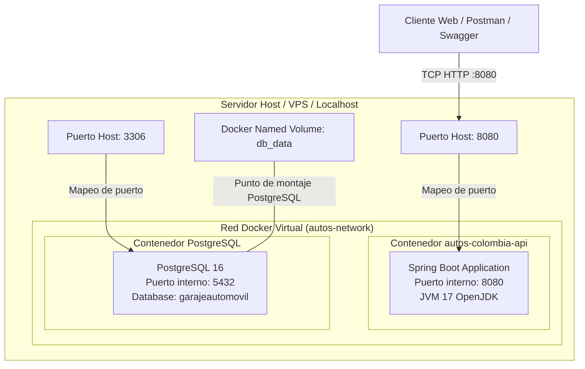

# Documento de Arquitectura de Software (SAD)
## Sistema de Gestión de Parqueadero "Autos Colombia" – Iteración 1
**Actividad:** S20 - Evidencia de Aprendizaje 1. Diseño Sistema de Información – Iteración 1  
**Institución:** Institución Universitaria Digital de Antioquia (IU Digital)  
**Asignatura:** Ingeniería de Software  
**Grupo:** [PREICA2602B020081](https://iudigital.instructure.com/courses/28333)  
**Profesor:** Esteban Montoya Molina  
**Rol Responsable:** 1 - Arquitecto Líder de Diseño  
**Estudiante:** Brayan Alejandro Durango Urrea  
**Fecha y Ubicación:** Octubre 2026, Medellín, Antioquia, Colombia  

---

## 1. Visión General del Sistema y Alcance

### 1.1 Propósito del Documento
El presente documento define la arquitectura integral de software para la **Iteración 1** del sistema de información de **Autos Colombia**, empresa dedicada a la operación de parqueaderos vehiculares bajo la modalidad de mensualidad y control de flujo de vehículos. 

El proyecto se desarrolla en modalidad individual. **Brayan Alejandro Durango Urrea** asume los roles de Analista de Requerimientos (RF/RNF e historias), Desarrollador Backend (API y persistencia) y Desarrollador Frontend / QA (interfaz web, pruebas y documentación). La interfaz web implementada no equivale a un prototipo de Figma.

### 1.2 Alcance de la Iteración 1
La **Iteración 1** se enfoca de manera prioritaria y exhaustiva en el núcleo transaccional del negocio:
* Control de acceso y autenticación segura basada en tokens JWT sin estado (stateless).
* Gestión de ingreso vehicular (captura de placa, datos del vehículo, validación de pico y placa para Bogotá D.C., asignación automática de celda por tipología y emisión de comprobante de ingreso con código QR).
* Gestión de salida vehicular (búsqueda de vehículo activo, cálculo de tiempo de permanencia, liberación transaccional de celda asignada y emisión de comprobante de salida con código QR).
* Registro y auditoría de novedades o incidentes presentados durante la estancia.
* Panel de control (Dashboard) con métricas de ocupación en tiempo real y exportación de reportes operativos en formato CSV.
* Auditoría transversal de cada transacción crítica para trazabilidad operacional.

---

## 2. Estilos y Patrones Arquitectónicos

### 2.1 Arquitectura en Capas (Layered Architecture)
El backend implementa un patrón estricto de **Arquitectura en 4 Capas** desacopladas con inversión de dependencias:

```
┌─────────────────────────────────────────────────────────────┐
│ 1. CAPA DE PRESENTACIÓN (Presentation Layer / REST API)     │
│    - Controllers (@RestController)                          │
│    - DTOs (Data Transfer Objects + Bean Validation)         │
│    - Configuración de Seguridad (Spring Security 6, JWT)    │
│    - Global Exception Handler (@RestControllerAdvice)       │
└──────────────────────────────┬──────────────────────────────┘
                               │ Inyección de Dependencias
                               ▼
┌─────────────────────────────────────────────────────────────┐
│ 2. CAPA DE DOMINIO Y NEGOCIO (Domain & Service Layer)       │
│    - Entidades de Negocio (Usuario, Vehiculo, Celda, etc.)  │
│    - Servicios de Negocio (@Service + @Transactional)       │
│    - Reglas de negocio (Pico y Placa, Asignación de celdas) │
│    - Enums de dominio (TipoVehiculo, EstadoCelda, etc.)     │
└──────────────────────────────┬──────────────────────────────┘
                               │ Inversión de Control
                               ▼
┌─────────────────────────────────────────────────────────────┐
│ 3. CAPA DE INFRAESTRUCTURA Y ACCESO A DATOS (Infrastructure)│
│    - Repositorios Spring Data JPA (JpaRepository)           │
│    - Consultas derivadas y JPQL optimizadas                 │
│    - Manejo de excepciones de persistencia                  │
│    - Migraciones de esquema con Flyway                      │
└──────────────────────────────┬──────────────────────────────┘
                               │ Conector JDBC (HikariCP)
                               ▼
┌─────────────────────────────────────────────────────────────┐
│ 4. CAPA DE DATOS Y PERSISTENCIA (Database Layer)            │
│    - PostgreSQL (base local Garajeautomovil)                │
│    - Codificación UTF-8 y transacciones ACID                │
│    - Integridad referencial con Foreign Keys y Checks       │
└─────────────────────────────────────────────────────────────┘
```

### 2.2 Patrones de Diseño de Software Implementados
1. **Data Transfer Object (DTO):** Aísla el modelo de dominio interno de las interfaces públicas expuestas vía HTTP, previniendo sobreexposición de datos sensibles (claves hash) y permitiendo validaciones declarativas mediante `jakarta.validation`.
2. **Repository Pattern:** Abstrae el acceso al motor de almacenamiento mediante interfaces de Spring Data JPA, desacoplando la lógica de negocio de la tecnología de persistencia.
3. **Filter Chain (Cadena de Responsabilidad):** Ejecutado en `JwtAuthenticationFilter` antes del despacho de peticiones HTTP a los controladores para validar tokens y poblar el `SecurityContext`.
4. **Builder Pattern (Lombok `@Builder`):** Facilita la construcción inmutable de objetos de dominio y DTOs con valores predeterminados seguros (`@Builder.Default` y `@PrePersist`).
5. **Controller Advice (AOP Exception Handling):** Centraliza el tratamiento de excepciones no controladas y de negocio (`ResourceNotFoundException`, `BusinessRuleException`, `MethodArgumentNotValidException`) transformándolas en respuestas estándar RFC 7807 / JSON unificado.
6. **Stateless Service Layer:** Servicios sin estado `@Service` thread-safe que gestionan transacciones atómicas mediante `@Transactional`.

---

## 3. Modelo C4 - Vistas Arquitectónicas

### 3.1 Nivel 1: Diagrama de Contexto del Sistema
Ilustra los actores del sistema y los límites de Autos Colombia con sistemas externos.



### 3.2 Nivel 2: Diagrama de Contenedores
Muestra la topología de contenedores y tecnologías de comunicación.

```mermaid
graph TD
    subgraph Cliente ["Capa Cliente"]
        Browser["Navegador Web / App Cliente<br/>[React / HTML5 / Figma Mockups]<br/>Interfaz gráfica para el operador y administrador"]
    end

    subgraph Host ["Servidor de Aplicación (Docker)"]
        BackendApp["Backend API REST<br/>[Spring Boot 3.2.5 / Java 17]<br/>Expone endpoints JSON con autenticación JWT"]
        SwaggerDoc["Swagger / OpenAPI 3<br/>[Springdoc]<br/>Documentación interactiva de la API"]
    end

    subgraph DataHost ["Servidor de Base de Datos (Docker)"]
        Database["Base de Datos Relacional<br/>[PostgreSQL 16]<br/>Almacena usuarios, vehículos, celdas y registros"]
        VolumeStorage["Volumen Docker Persistente<br/>[db_data]<br/>Persistencia física de datos"]
    end

    Browser -->|HTTP REST / JSON / Bearer JWT (Puerto 8080)| BackendApp
    Browser -->|Consulta documentación (Puerto 8080)| SwaggerDoc
    BackendApp -->|JDBC / TCP Pool Hikari (Puerto 3306)| Database
    Database -->|Lee y escribe bloques de datos| VolumeStorage
```

### 3.3 Nivel 3: Diagrama de Componentes (Backend Spring Boot)
Detalla los módulos funcionales internos del contenedor backend.



---

## 4. Atributos de Calidad (Requerimientos No Funcionales - RNF)

1. **Seguridad (RNF-01 a RNF-04):**
   * Autenticación basada en JWT (HMAC-SHA256) con expiración configurable (8 horas estándar).
   * Almacenamiento seguro de contraseñas mediante algoritmo **BCrypt** con factor de costo 10.
   * Control de acceso basado en roles (RBAC): `ADMINISTRADOR` y `OPERADOR`.
   * Protección contra fuerza bruta mediante bloqueo temporal de cuentas (15 minutos tras 3 intentos fallidos consecutivos).
2. **Rendimiento y Concurrencia (RNF-05 a RNF-07):**
   * Tiempos de respuesta para operaciones de entrada/salida inferiores a 500 ms bajo carga nominal.
   * Manejo de pool de conexiones optimizado con HikariCP (tamaño de pool: 10 conexiones simultáneas).
   * Celdas bloqueadas a nivel transaccional para evitar condiciones de carrera (Race Conditions) en asignación simultánea.
3. **Integridad y Trazabilidad (RNF-08 a RNF-10):**
   * Motor InnoDB con propiedades ACID completas.
   * Tabla `auditoria_log` que registra de manera inmutable la IP de origen, usuario actor, entidad modificada, timestamp y estado de cada transacción crítica.
   * Claves foráneas con restricciones ON DELETE RESTRICT para salvaguardar el historial operacional.
4. **Mantenibilidad y Portabilidad (RNF-11 a RNF-14):**
   * Código desacoplado siguiendo principios SOLID y Clean Code.
   * Contenedorización completa con Docker y orquestación con Docker Compose.
   * Control de versiones de esquema de base de datos con Flyway para despliegues reproducibles.
    * Objetivo de cobertura automatizada superior al 70% mediante JaCoCo; la medición local actual alcanza 90,2% de líneas.

---

## 5. Registro de Decisiones de Arquitectura (ADRs)

### ADR-01: Selección de Spring Boot 3.2.5 y Java 17 LTS
* **Estado:** Aprobado.
* **Contexto:** Se requiere un entorno robusto, tipado estático moderno y soporte corporativo a largo plazo.
* **Decisión:** Adoptar Java 17 LTS con Spring Boot 3.2.5 aprovechando el nuevo Spring Security 6, Jakarta EE 10 y mejoras de rendimiento de la JVM.
* **Consecuencias:** Mayor productividad, ecosistema maduro de pruebas (JUnit 5, Mockito) e integración nativa con Swagger OpenAPI.

### ADR-02: Base de Datos Relacional PostgreSQL y Flyway
* **Estado:** Aprobado.
* **Contexto:** El negocio de parqueadero requiere consistencia estricta en el estado de ocupación de celdas y auditoría financiera/operativa.
* **Decisión:** Utilizar PostgreSQL para la base local `Garajeautomovil` y PostgreSQL 16 en Docker, con migraciones automáticas mediante Flyway.
* **Consecuencias:** Garantía ACID contra pérdidas de datos y evolución controlada del esquema DDL en equipo.

### ADR-03: Seguridad Stateless con Tokens JWT y Desacoplamiento de PasswordEncoder
* **Estado:** Aprobado y Refactorizado.
* **Contexto:** Se identificó una dependencia circular potencial entre `SecurityConfig`, `JwtAuthenticationFilter` y `AuthService`.
* **Decisión:** Desacoplar la creación del bean `PasswordEncoder` en una clase de configuración independiente (`PasswordEncoderConfig`) y mantener la sesión HTTP estrictamente `STATELESS`.
* **Consecuencias:** Eliminación de ciclos de beans en el contenedor Spring, arranque limpio del ApplicationContext y compatibilidad total con pruebas de integración en memoria (H2).

### ADR-04: Estrategia de Asignación Automática de Celdas
* **Estado:** Aprobado.
* **Contexto:** Al ingresar un vehículo, el operador no debe perder tiempo eligiendo celdas manualmente.
* **Decisión:** El sistema asigna automáticamente la primera celda disponible filtrada por tipología (`CARRO`, `MOTO`, `CAMIONETA`) ordenada por número ascendente, actualizando su estado a `OCUPADA` dentro de la misma transacción.
* **Consecuencias:** Operación ágil en menos de 2 segundos en la garita de entrada y prevención de sobrecupos.

### ADR-05: Desacoplamiento del Algoritmo de Pico y Placa
* **Estado:** Aprobado.
* **Contexto:** La normativa de Pico y Placa en Bogotá cambia periódicamente según decretos distritales.
* **Decisión:** Encapsular la regla en un servicio especializado (`PicoYPlacaService`) que analiza el último dígito numérico de la placa y el día hábil, permitiendo futuras parametrizaciones dinámicas sin alterar la lógica de admisión vehicular.
* **Consecuencias:** Alta cohesión y facilidad de mantenimiento ante cambios normativos.

### ADR-06: Generación de Comprobantes con Código QR en Base64
* **Estado:** Aprobado.
* **Contexto:** Se requiere entregar comprobantes impresos o digitales legibles tanto por personas como por escáneres ópticos.
* **Decisión:** Emplear la librería ZXing para generar códigos QR bidimensionales codificados en Base64 que contienen el código único del ticket, placa, celda y timestamp.
* **Consecuencias:** Permite incrustar la imagen directamente en interfaces web o formatos PDF sin almacenar archivos binarios en el disco del servidor.

---

## 6. Diagrama de Despliegue e Infraestructura


