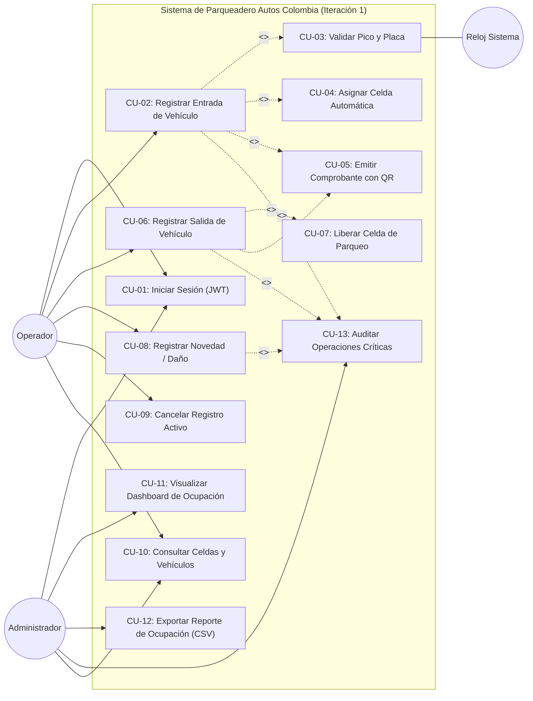
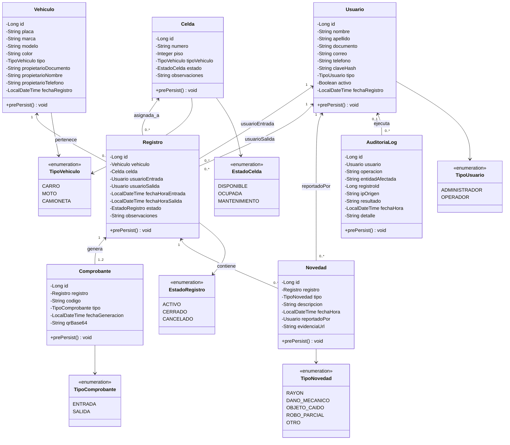
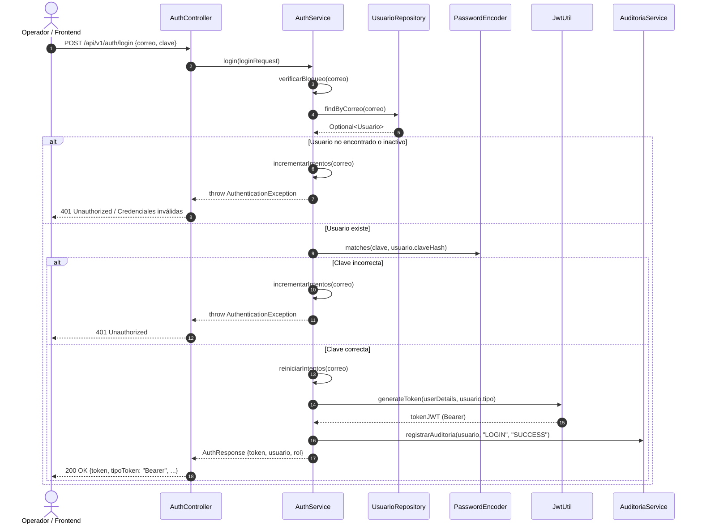
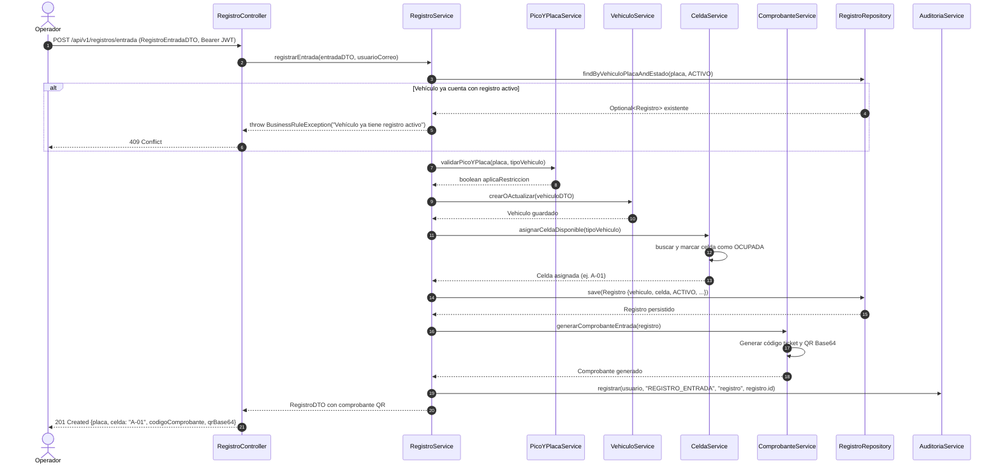
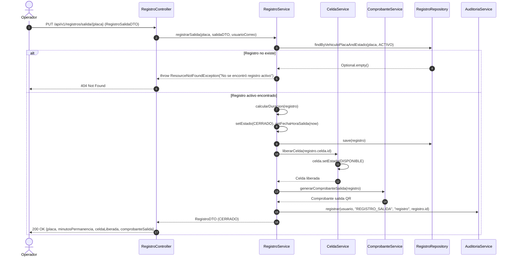
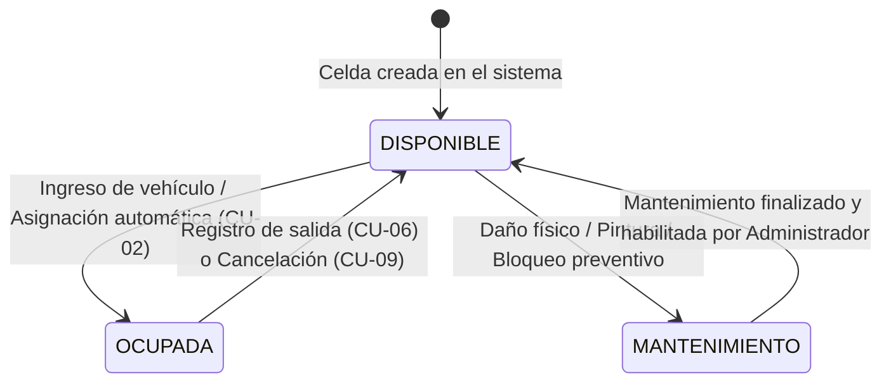
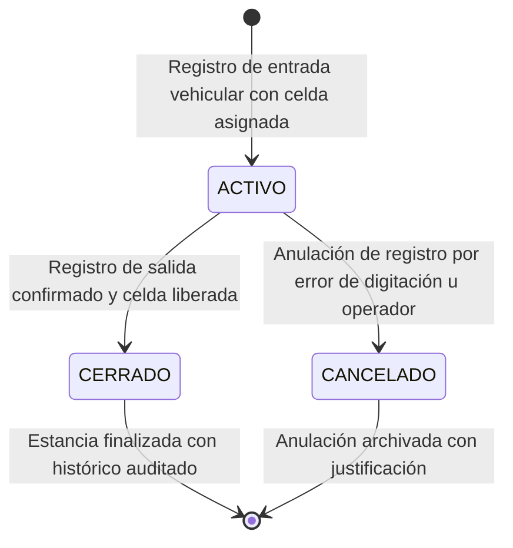

# Especificación de Diagramas UML
## Sistema de Información "Autos Colombia" – Iteración 1
**Actividad:** S20 - Evidencia de Aprendizaje 1. Diseño Sistema de Información – Iteración 1  
**Institución:** Institución Universitaria Digital de Antioquia (IU Digital)  
**Asignatura:** Ingeniería de Software  
**Grupo:** [PREICA2602B020081](https://iudigital.instructure.com/courses/28333)  
**Profesor:** Esteban Montoya Molina  
**Rol Responsable:** 1 - Arquitecto Líder de Diseño  
**Estudiante:** Brayan Alejandro Durango Urrea  
**Fecha y Ubicación:** Octubre 2026, Medellín, Antioquia, Colombia  

---

## 1. Diagrama de Casos de Uso del Sistema

El diagrama de casos de uso modela los requisitos funcionales de la Iteración 1 desde la perspectiva de los actores que interactúan con el sistema:
* **Operador de Parqueadero:** Encargado de la operación en garita (ingreso, salida, novedades y consulta de celdas).
* **Administrador del Sistema:** Supervisión estratégica, gestión de usuarios, auditoría y métricas.
* **Sistema / Reloj del Sistema:** Actor secundario temporal para la validación automática de normativas distritales.



### Tabla de Especificación Resumida de Casos de Uso

| Código | Nombre del Caso de Uso | Actor Principal | Precondición | Postcondición |
|---|---|---|---|---|
| **CU-01** | Iniciar Sesión | Operador / Admin | Usuario registrado y activo | Token JWT retornado con rol asignado |
| **CU-02** | Registrar Entrada | Operador | Sesión activa, celda disponible | Registro ACTIVO creado, celda OCUPADA, comprobante QR generado |
| **CU-03** | Validar Pico y Placa | Sistema | Placa del vehículo enviada | Autorización de ingreso o advertencia si aplica restricción |
| **CU-04** | Asignar Celda Automática | Sistema | Tipo de vehículo identificado | Celda física asignada por tipo (CARRO, MOTO, CAMIONETA) |
| **CU-05** | Emitir Comprobante con QR | Sistema | Registro de entrada o salida completado | Código alfanumérico único e imagen QR en Base64 generados |
| **CU-06** | Registrar Salida | Operador | Vehículo con registro ACTIVO | Registro pasa a CERRADO, se registra fecha/hora salida |
| **CU-07** | Liberar Celda | Sistema | Salida confirmada | Celda pasa a estado DISPONIBLE |
| **CU-08** | Registrar Novedad | Operador | Registro activo o vehículo identificado | Novedad tipificada almacenada con descripción y evidencia |
| **CU-09** | Cancelar Registro | Operador / Admin | Registro erróneo activo | Registro pasa a CANCELADO y la celda se libera |
| **CU-11** | Visualizar Dashboard | Administrador | Rol ADMINISTRADOR autenticado | Métricas de ocupación, total celdas y vehículos activos |
| **CU-12** | Exportar Reporte CSV | Administrador | Rol ADMINISTRADOR autenticado | Archivo CSV estructurado con registros y tiempos de estancia |
| **CU-13** | Auditar Operación | Sistema | Transacción ejecutada | Registro inmutable en tabla `auditoria_log` |

---

## 2. Diagrama de Clases UML (Modelo de Dominio y Capas)

Muestra las entidades del negocio, sus atributos, tipos de datos, cardinalidades y la estructura de servicios y controladores.



---

## 3. Diagramas de Secuencia UML

### 3.1 Flujo 1: Autenticación y Generación de Token JWT
Representa la verificación de credenciales, control de fuerza bruta y expedición del token criptográfico.



### 3.2 Flujo 2: Registro de Entrada Vehicular
Representa el proceso completo de validación de Pico y Placa, alta/actualización del vehículo, asignación atómica de celda disponible y creación del comprobante con código QR.



### 3.3 Flujo 3: Registro de Salida y Liberación de Celda
Ilustra la búsqueda del vehículo, cierre de estancia, cálculo de permanencia, liberación física de la celda y comprobante de egreso.



---

## 4. Diagrama de Estados UML

### 4.1 Ciclo de Vida de una Celda de Parqueadero
Describe las transiciones de estado de las bahías de estacionamiento.



### 4.2 Ciclo de Vida de un Registro Vehicular



---

## 5. Diagrama de Paquetes UML

Estructura de organización de paquetes Java en el proyecto Spring Boot:

```mermaid
classDiagram
    package com_autoscolombia {
        class AutosColombiaApplication
    }

    package domain {
        package enums {
            class TipoUsuario
            class TipoVehiculo
            class EstadoCelda
            class EstadoRegistro
            class TipoNovedad
            class TipoComprobante
        }
        package model {
            class Usuario
            class Vehiculo
            class Celda
            class Registro
            class Comprobante
            class Novedad
            class AuditoriaLog
        }
        package service {
            class AuthService
            class RegistroService
            class CeldaService
            class VehiculoService
            class PicoYPlacaService
            class ComprobanteService
            class NovedadService
            class ReporteService
            class AuditoriaService
        }
    }

    package infrastructure {
        package repository {
            class UsuarioRepository
            class VehiculoRepository
            class CeldaRepository
            class RegistroRepository
            class ComprobanteRepository
            class NovedadRepository
            class AuditoriaLogRepository
        }
        package exception {
            class GlobalExceptionHandler
            class ResourceNotFoundException
            class BusinessRuleException
            class AuthenticationException
        }
    }

    package presentation {
        package controllers {
            class AuthController
            class RegistroController
            class VehiculoController
            class CeldaController
            class NovedadController
            class ReporteController
            class UsuarioController
        }
        package dto {
            class AuthResponse
            class LoginRequest
            class RegistroEntradaDTO
            class RegistroSalidaDTO
            class RegistroDTO
            class VehiculoDTO
            class CeldaDTO
            class ComprobanteDTO
            class DashboardDTO
        }
        package config {
            class SecurityConfig
            class PasswordEncoderConfig
            class JwtAuthenticationFilter
        }
    }

    package util {
        class JwtUtil
    }

    presentation ..> domain : utiliza
    presentation ..> infrastructure : maneja excepciones
    domain ..> infrastructure : implementa persistencia
    presentation ..> util : valida tokens
```
