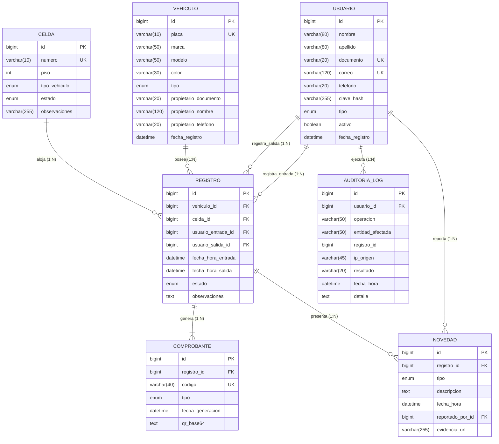

# Modelo Entidad-Relación (MER), Modelo Relacional (MR) y Modelo Físico (MF)
## Sistema de Información "Autos Colombia" – Iteración 1
**Actividad:** S20 - Evidencia de Aprendizaje 1. Diseño Sistema de Información – Iteración 1  
**Institución:** Institución Universitaria Digital de Antioquia (IU Digital)  
**Asignatura:** Ingeniería de Software  
**Grupo:** [PREICA2602B020081](https://iudigital.instructure.com/courses/28333)  
**Profesor:** Esteban Montoya Molina  
**Rol Responsable:** 1 - Arquitecto Líder de Diseño  
**Estudiante:** Brayan Alejandro Durango Urrea  
**Fecha y Ubicación:** Octubre 2026, Medellín, Antioquia, Colombia  

---

## 1. Modelo Entidad-Relación Conceptual (MER)

El modelo conceptual describe las entidades del negocio, sus atributos esenciales y las relaciones que rigen el dominio del parqueadero en la Iteración 1:

### 1.1 Entidades y Atributos Conceptuales
* **USUARIO:** Representa al personal autorizado para operar el sistema (operadores de garita y administradores).  
  *Atributos:* Identificador, Nombres, Apellidos, Documento, Correo Electrónico, Teléfono, Clave de Acceso, Rol/Tipo, Estado Activo, Fecha de Registro.
* **VEHICULO:** Automotores que ingresan a hacer uso de los servicios de parqueadero.  
  *Atributos:* Identificador, Placa, Marca, Línea/Modelo, Color, Tipo de Vehículo, Documento Propietario, Nombre Propietario, Teléfono Propietario, Fecha de Registro.
* **CELDA:** Espacios físicos demarcados y numerados donde se estacionan los vehículos.  
  *Atributos:* Identificador, Número de Celda, Nivel/Piso, Tipo de Vehículo Admitido, Estado Actual, Observaciones Físicas.
* **REGISTRO:** Transacción central que modela la estancia de un vehículo desde su ingreso hasta su retiro.  
  *Atributos:* Identificador, Vehículo Asociado, Celda Asignada, Operador Entrada, Operador Salida, Fecha/Hora Entrada, Fecha/Hora Salida, Estado de Estancia, Observaciones de Turno.
* **COMPROBANTE:** Documento probatorio emitido al conductor con código único y código QR.  
  *Atributos:* Identificador, Registro Vinculado, Código Único, Tipo (Entrada/Salida), Fecha de Generación, Código QR en Base64.
* **NOVEDAD:** Registro formal de incidentes, rayones, fugas o contingencias detectadas en el vehículo.  
  *Atributos:* Identificador, Registro Asociado, Categoría de Novedad, Descripción Circunstanciada, Fecha/Hora, Operador Reportante, Evidencia Fotográfica (URL).
* **AUDITORIA_LOG:** Pista de auditoría inmutable para supervisión de seguridad y operaciones.  
  *Atributos:* Identificador, Usuario Ejecutor, Tipo de Operación, Entidad Afectada, ID del Registro, Dirección IP, Resultado de la Transacción, Timestamp, Detalle Técnico.

### 1.2 Reglas del Negocio y Cardinalidades (MER)
1. **USUARIO (1) ── (0..N) REGISTRO [Entrada]:** Un usuario operador puede admitir múltiples vehículos. Cada registro de entrada es efectuado obligatoriamente por un único usuario operador.
2. **USUARIO (0..1) ── (0..N) REGISTRO [Salida]:** Un usuario operador puede registrar la salida de múltiples vehículos. Mientras un registro esté activo, el usuario de salida es nulo; al cerrarse, se vincula al operador en turno.
3. **VEHICULO (1) ── (0..N) REGISTRO:** Un vehículo puede ingresar múltiples veces al parqueadero en diferentes fechas, pero solo puede tener **un registro en estado ACTIVO a la vez**.
4. **CELDA (1) ── (0..N) REGISTRO:** Una celda física alberga a muchos vehículos a lo largo del tiempo, pero en un instante dado solo puede estar ocupada por un registro con estado ACTIVO.
5. **REGISTRO (1) ── (1..2) COMPROBANTE:** Todo registro produce obligatoriamente un comprobante de ENTRADA al crearse y un comprobante de SALIDA al concluir la estancia.
6. **REGISTRO (1) ── (0..N) NOVEDAD:** Una estancia vehicular puede no presentar novedades o reportar múltiples anomalías.
7. **USUARIO (1) ── (0..N) NOVEDAD:** Cada novedad es registrada y firmada digitalmente por el usuario operador en servicio.
8. **USUARIO (0..1) ── (0..N) AUDITORIA_LOG:** Toda acción sensible genera una traza de auditoría asociada al usuario autenticado.

---

## 2. Diagrama Entidad-Relación Físico (DER)



---

## 3. Modelo Relacional Lógico (MR)

El **Modelo Relacional (MR)** traduce las entidades y relaciones a esquemas de tablas relacionales normalizadas en **Tercera Forma Normal (3FN)**:
* **Primera Forma Normal (1FN):** Todos los atributos son atómicos (no existen grupos repetitivos ni atributos multivaluados).
* **Segunda Forma Normal (2FN):** No existen dependencias funcionales parciales; todos los atributos no clave dependen en su totalidad de la clave primaria.
* **Tercera Forma Normal (3FN):** No existen dependencias funcionales transitivas; ningún atributo no clave depende de otro atributo no clave.

### Notación Relacional Estándar:
* `<u>Atributo</u>`: Clave Primaria (Primary Key - PK)
* `*Atributo*`: Clave Foránea (Foreign Key - FK)
* `[UK]`: Clave Única Alternativa (Unique Key)

1. **USUARIO** (  
   <u>id</u>, nombre, apellido, documento [UK], correo [UK], telefono, clave_hash, tipo, activo, fecha_registro  
   )
2. **VEHICULO** (  
   <u>id</u>, placa [UK], marca, modelo, color, tipo, propietario_documento, propietario_nombre, propietario_telefono, fecha_registro  
   )
3. **CELDA** (  
   <u>id</u>, numero [UK], piso, tipo_vehiculo, estado, observaciones  
   )
4. **REGISTRO** (  
   <u>id</u>, *vehiculo_id*, *celda_id*, *usuario_entrada_id*, *usuario_salida_id*, fecha_hora_entrada, fecha_hora_salida, estado, observaciones  
   )  
   * FK `vehiculo_id` $\rightarrow$ `VEHICULO(id)`  
   * FK `celda_id` $\rightarrow$ `CELDA(id)`  
   * FK `usuario_entrada_id` $\rightarrow$ `USUARIO(id)`  
   * FK `usuario_salida_id` $\rightarrow$ `USUARIO(id)`  
5. **COMPROBANTE** (  
   <u>id</u>, *registro_id*, codigo [UK], tipo, fecha_generacion, qr_base64  
   )  
   * FK `registro_id` $\rightarrow$ `REGISTRO(id)`  
6. **NOVEDAD** (  
   <u>id</u>, *registro_id*, tipo, descripcion, fecha_hora, *reportado_por_id*, evidencia_url  
   )  
   * FK `registro_id` $\rightarrow$ `REGISTRO(id)`  
   * FK `reportado_por_id` $\rightarrow$ `USUARIO(id)`  
7. **AUDITORIA_LOG** (  
   <u>id</u>, *usuario_id*, operacion, entidad_afectada, registro_id, ip_origen, resultado, fecha_hora, detalle  
   )  
   * FK `usuario_id` $\rightarrow$ `USUARIO(id)`  

---

## 4. Modelo Físico (MF) – Diccionario de Datos y DDL SQL

El **Modelo Físico (MF)** define la implementación concreta en el motor relacional **MySQL 8.0** con motor transaccional **InnoDB** y codificación **`utf8mb4`**.

### 4.1 Diccionario de Datos de Tablas Físicas

#### Tabla: `usuario`
| Columna | Tipo Físico | Nullable | Restricción | Default | Descripción |
|---|---|---|---|---|---|
| `id` | BIGINT | NO | PRIMARY KEY AUTO_INCREMENT | Auto | ID secuencial único |
| `nombre` | VARCHAR(80) | NO | Ninguna | N/A | Nombre del usuario |
| `apellido` | VARCHAR(80) | NO | Ninguna | N/A | Apellido del usuario |
| `documento` | VARCHAR(20) | NO | UNIQUE (`uk_usuario_documento`) | N/A | Cédula / documento |
| `correo` | VARCHAR(120) | NO | UNIQUE (`uk_usuario_correo`) | N/A | Correo institucional |
| `telefono` | VARCHAR(20) | SÍ | Ninguna | NULL | Teléfono móvil |
| `clave_hash` | VARCHAR(255) | NO | Ninguna | N/A | Hash BCrypt (costo 10) |
| `tipo` | ENUM | NO | 'ADMINISTRADOR', 'OPERADOR' | 'OPERADOR' | Rol en la plataforma |
| `activo` | BOOLEAN | NO | Ninguna | TRUE | Estado de habilitación |
| `fecha_registro` | DATETIME | NO | Ninguna | CURRENT_TIMESTAMP | Timestamp de creación |

#### Tabla: `vehiculo`
| Columna | Tipo Físico | Nullable | Restricción | Default | Descripción |
|---|---|---|---|---|---|
| `id` | BIGINT | NO | PRIMARY KEY AUTO_INCREMENT | Auto | ID único de vehículo |
| `placa` | VARCHAR(10) | NO | UNIQUE (`uk_vehiculo_placa`) | N/A | Placa colombiana |
| `marca` | VARCHAR(50) | NO | Ninguna | N/A | Marca fabricante |
| `modelo` | VARCHAR(50) | NO | Ninguna | N/A | Línea o modelo |
| `color` | VARCHAR(30) | NO | Ninguna | N/A | Color del vehículo |
| `tipo` | ENUM | NO | 'CARRO', 'MOTO', 'CAMIONETA' | 'CARRO' | Tipología vehicular |
| `propietario_documento` | VARCHAR(20) | SÍ | Ninguna | NULL | Documento del titular |
| `propietario_nombre` | VARCHAR(120) | SÍ | Ninguna | NULL | Nombre del titular |
| `propietario_telefono` | VARCHAR(20) | SÍ | Ninguna | NULL | Teléfono del titular |
| `fecha_registro` | DATETIME | NO | Ninguna | CURRENT_TIMESTAMP | Timestamp de alta |

#### Tabla: `celda`
| Columna | Tipo Físico | Nullable | Restricción | Default | Descripción |
|---|---|---|---|---|---|
| `id` | BIGINT | NO | PRIMARY KEY AUTO_INCREMENT | Auto | ID único de celda |
| `numero` | VARCHAR(10) | NO | UNIQUE (`uk_celda_numero`) | N/A | Nomenclatura (ej. A-01) |
| `piso` | INT | NO | Ninguna | N/A | Piso o nivel de ubicación |
| `tipo_vehiculo` | ENUM | NO | 'CARRO', 'MOTO', 'CAMIONETA' | 'CARRO' | Tipo vehicular apto |
| `estado` | ENUM | NO | 'DISPONIBLE', 'OCUPADA', 'MANTENIMIENTO' | 'DISPONIBLE' | Estado operativo |
| `observaciones` | VARCHAR(255) | SÍ | Ninguna | NULL | Notas adicionales |

#### Tabla: `registro`
| Columna | Tipo Físico | Nullable | Restricción | Default | Descripción |
|---|---|---|---|---|---|
| `id` | BIGINT | NO | PRIMARY KEY AUTO_INCREMENT | Auto | ID único de estancia |
| `vehiculo_id` | BIGINT | NO | FK (`vehiculo.id`) | N/A | Vehículo estacionado |
| `celda_id` | BIGINT | NO | FK (`celda.id`) | N/A | Celda ocupada |
| `usuario_entrada_id`| BIGINT | NO | FK (`usuario.id`) | N/A | Operador de entrada |
| `usuario_salida_id` | BIGINT | SÍ | FK (`usuario.id`) | NULL | Operador de salida |
| `fecha_hora_entrada`| DATETIME | NO | Ninguna | CURRENT_TIMESTAMP | Momento de ingreso |
| `fecha_hora_salida` | DATETIME | SÍ | Ninguna | NULL | Momento de egreso |
| `estado` | ENUM | NO | 'ACTIVO', 'CERRADO', 'CANCELADO' | 'ACTIVO' | Estado de la estancia |
| `observaciones` | TEXT | SÍ | Ninguna | NULL | Anotaciones generales |
* **Constraint CHECK:** `chk_registro_salida CHECK (estado = 'ACTIVO' OR fecha_hora_salida IS NOT NULL)`

#### Tabla: `comprobante`
| Columna | Tipo Físico | Nullable | Restricción | Default | Descripción |
|---|---|---|---|---|---|
| `id` | BIGINT | NO | PRIMARY KEY AUTO_INCREMENT | Auto | ID del comprobante |
| `registro_id` | BIGINT | NO | FK (`registro.id`) | N/A | Estancia vinculada |
| `codigo` | VARCHAR(40) | NO | UNIQUE (`uk_comprobante_codigo`) | N/A | Código único del ticket |
| `tipo` | ENUM | NO | 'ENTRADA', 'SALIDA' | N/A | Tipo de comprobante |
| `fecha_generacion` | DATETIME | NO | Ninguna | CURRENT_TIMESTAMP | Fecha de expedición |
| `qr_base64` | TEXT | SÍ | Ninguna | NULL | Imagen QR en Base64 |

#### Tabla: `novedad`
| Columna | Tipo Físico | Nullable | Restricción | Default | Descripción |
|---|---|---|---|---|---|
| `id` | BIGINT | NO | PRIMARY KEY AUTO_INCREMENT | Auto | ID único de novedad |
| `registro_id` | BIGINT | NO | FK (`registro.id`) | N/A | Estancia relacionada |
| `tipo` | ENUM | NO | 'RAYON', 'DANO_MECANICO', 'OBJETO_CAIDO', 'ROBO_PARCIAL', 'OTRO' | N/A | Tipo de anomalía |
| `descripcion` | TEXT | NO | Ninguna | N/A | Relato del incidente |
| `fecha_hora` | DATETIME | NO | Ninguna | CURRENT_TIMESTAMP | Timestamp de novedad |
| `reportado_por_id` | BIGINT | NO | FK (`usuario.id`) | N/A | Operador que reporta |
| `evidencia_url` | VARCHAR(255) | SÍ | Ninguna | NULL | URL soporte fotográfico |

#### Tabla: `auditoria_log`
| Columna | Tipo Físico | Nullable | Restricción | Default | Descripción |
|---|---|---|---|---|---|
| `id` | BIGINT | NO | PRIMARY KEY AUTO_INCREMENT | Auto | ID secuencial del log |
| `usuario_id` | BIGINT | SÍ | FK (`usuario.id`) | NULL | Usuario que actuó |
| `operacion` | VARCHAR(50) | NO | Ninguna | N/A | Nombre de la operación |
| `entidad_afectada` | VARCHAR(50) | SÍ | Ninguna | NULL | Tabla afectada |
| `registro_id` | BIGINT | SÍ | Ninguna | NULL | ID del registro |
| `ip_origen` | VARCHAR(45) | SÍ | Ninguna | NULL | IPv4 o IPv6 origen |
| `resultado` | VARCHAR(20) | NO | Ninguna | N/A | 'EXITO', 'FALLO' |
| `fecha_hora` | DATETIME | NO | INDEX (`idx_auditoria_fecha`)| CURRENT_TIMESTAMP | Timestamp de auditoría |
| `detalle` | TEXT | SÍ | Ninguna | NULL | Datos de depuración |

---

### 4.2 Script DDL SQL Completo (MySQL 8.0 / Flyway)

```sql
-- Creación de tabla USUARIO
CREATE TABLE usuario (
    id              BIGINT       NOT NULL AUTO_INCREMENT,
    nombre          VARCHAR(80)  NOT NULL,
    apellido        VARCHAR(80)  NOT NULL,
    documento       VARCHAR(20)  NOT NULL,
    correo          VARCHAR(120) NOT NULL,
    telefono        VARCHAR(20)  NULL,
    clave_hash      VARCHAR(255) NOT NULL,
    tipo            ENUM('ADMINISTRADOR','OPERADOR') NOT NULL DEFAULT 'OPERADOR',
    activo          BOOLEAN      NOT NULL DEFAULT TRUE,
    fecha_registro  DATETIME     NOT NULL DEFAULT CURRENT_TIMESTAMP,
    CONSTRAINT pk_usuario PRIMARY KEY (id),
    CONSTRAINT uk_usuario_documento UNIQUE (documento),
    CONSTRAINT uk_usuario_correo    UNIQUE (correo)
) ENGINE=InnoDB DEFAULT CHARSET=utf8mb4 COLLATE=utf8mb4_unicode_ci;

-- Creación de tabla VEHICULO
CREATE TABLE vehiculo (
    id                       BIGINT       NOT NULL AUTO_INCREMENT,
    placa                    VARCHAR(10)  NOT NULL,
    marca                    VARCHAR(50)  NOT NULL,
    modelo                   VARCHAR(50)  NOT NULL,
    color                    VARCHAR(30)  NOT NULL,
    tipo                     ENUM('CARRO','MOTO','CAMIONETA') NOT NULL DEFAULT 'CARRO',
    propietario_documento    VARCHAR(20)  NULL,
    propietario_nombre       VARCHAR(120) NULL,
    propietario_telefono     VARCHAR(20)  NULL,
    fecha_registro           DATETIME     NOT NULL DEFAULT CURRENT_TIMESTAMP,
    CONSTRAINT pk_vehiculo PRIMARY KEY (id),
    CONSTRAINT uk_vehiculo_placa UNIQUE (placa)
) ENGINE=InnoDB DEFAULT CHARSET=utf8mb4 COLLATE=utf8mb4_unicode_ci;

-- Creación de tabla CELDA
CREATE TABLE celda (
    id            BIGINT      NOT NULL AUTO_INCREMENT,
    numero        VARCHAR(10) NOT NULL,
    piso          INT         NOT NULL,
    tipo_vehiculo ENUM('CARRO','MOTO','CAMIONETA') NOT NULL DEFAULT 'CARRO',
    estado        ENUM('DISPONIBLE','OCUPADA','MANTENIMIENTO') NOT NULL DEFAULT 'DISPONIBLE',
    observaciones VARCHAR(255) NULL,
    CONSTRAINT pk_celda PRIMARY KEY (id),
    CONSTRAINT uk_celda_numero UNIQUE (numero)
) ENGINE=InnoDB DEFAULT CHARSET=utf8mb4 COLLATE=utf8mb4_unicode_ci;

-- Creación de tabla REGISTRO
CREATE TABLE registro (
    id                 BIGINT   NOT NULL AUTO_INCREMENT,
    vehiculo_id        BIGINT   NOT NULL,
    celda_id           BIGINT   NOT NULL,
    usuario_entrada_id BIGINT   NOT NULL,
    usuario_salida_id  BIGINT   NULL,
    fecha_hora_entrada DATETIME NOT NULL DEFAULT CURRENT_TIMESTAMP,
    fecha_hora_salida  DATETIME NULL,
    estado             ENUM('ACTIVO','CERRADO','CANCELADO') NOT NULL DEFAULT 'ACTIVO',
    observaciones      TEXT     NULL,
    CONSTRAINT pk_registro PRIMARY KEY (id),
    CONSTRAINT fk_registro_vehiculo        FOREIGN KEY (vehiculo_id)        REFERENCES vehiculo (id),
    CONSTRAINT fk_registro_celda           FOREIGN KEY (celda_id)           REFERENCES celda (id),
    CONSTRAINT fk_registro_usuario_entrada FOREIGN KEY (usuario_entrada_id) REFERENCES usuario (id),
    CONSTRAINT fk_registro_usuario_salida  FOREIGN KEY (usuario_salida_id)  REFERENCES usuario (id),
    CONSTRAINT chk_registro_salida CHECK (estado = 'ACTIVO' OR fecha_hora_salida IS NOT NULL)
) ENGINE=InnoDB DEFAULT CHARSET=utf8mb4 COLLATE=utf8mb4_unicode_ci;

CREATE INDEX idx_registro_vehiculo ON registro (vehiculo_id);
CREATE INDEX idx_registro_celda    ON registro (celda_id);
CREATE INDEX idx_registro_estado   ON registro (estado);

-- Creación de tabla NOVEDAD
CREATE TABLE novedad (
    id               BIGINT       NOT NULL AUTO_INCREMENT,
    registro_id      BIGINT       NOT NULL,
    tipo             ENUM('RAYON','DANO_MECANICO','OBJETO_CAIDO','ROBO_PARCIAL','OTRO') NOT NULL,
    descripcion      TEXT         NOT NULL,
    fecha_hora       DATETIME     NOT NULL DEFAULT CURRENT_TIMESTAMP,
    reportado_por_id BIGINT       NOT NULL,
    evidencia_url    VARCHAR(255) NULL,
    CONSTRAINT pk_novedad PRIMARY KEY (id),
    CONSTRAINT fk_novedad_registro FOREIGN KEY (registro_id)      REFERENCES registro (id),
    CONSTRAINT fk_novedad_usuario  FOREIGN KEY (reportado_por_id) REFERENCES usuario (id)
) ENGINE=InnoDB DEFAULT CHARSET=utf8mb4 COLLATE=utf8mb4_unicode_ci;

CREATE INDEX idx_novedad_registro ON novedad (registro_id);

-- Creación de tabla COMPROBANTE
CREATE TABLE comprobante (
    id               BIGINT       NOT NULL AUTO_INCREMENT,
    registro_id      BIGINT       NOT NULL,
    codigo           VARCHAR(40)  NOT NULL,
    tipo             ENUM('ENTRADA','SALIDA') NOT NULL,
    fecha_generacion DATETIME     NOT NULL DEFAULT CURRENT_TIMESTAMP,
    qr_base64        TEXT         NULL,
    CONSTRAINT pk_comprobante PRIMARY KEY (id),
    CONSTRAINT uk_comprobante_codigo UNIQUE (codigo),
    CONSTRAINT fk_comprobante_registro FOREIGN KEY (registro_id) REFERENCES registro (id)
) ENGINE=InnoDB DEFAULT CHARSET=utf8mb4 COLLATE=utf8mb4_unicode_ci;

CREATE INDEX idx_comprobante_registro ON comprobante (registro_id);

-- Creación de tabla AUDITORIA_LOG
CREATE TABLE auditoria_log (
    id               BIGINT       NOT NULL AUTO_INCREMENT,
    usuario_id       BIGINT       NULL,
    operacion        VARCHAR(50)  NOT NULL,
    entidad_afectada VARCHAR(50)  NULL,
    registro_id      BIGINT       NULL,
    ip_origen        VARCHAR(45)  NULL,
    resultado        VARCHAR(20)  NOT NULL,
    fecha_hora       DATETIME     NOT NULL DEFAULT CURRENT_TIMESTAMP,
    detalle          TEXT         NULL,
    CONSTRAINT pk_auditoria PRIMARY KEY (id),
    CONSTRAINT fk_auditoria_usuario FOREIGN KEY (usuario_id) REFERENCES usuario (id)
) ENGINE=InnoDB DEFAULT CHARSET=utf8mb4 COLLATE=utf8mb4_unicode_ci;

CREATE INDEX idx_auditoria_fecha ON auditoria_log (fecha_hora);
```
