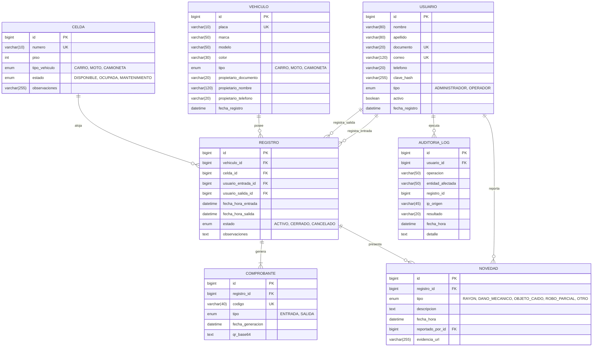

# Modelo Entidad-Relación (MER / DER) y Diccionario de Datos
## Sistema de Información "Autos Colombia" – Iteración 1
**Actividad:** S20 - Evidencia de Aprendizaje 1. Diseño Sistema de Información – Iteración 1  
**Institución:** Institución Universitaria Digital de Antioquia (IU Digital)  
**Asignatura:** Ingeniería de Software  
**Grupo:** [PREICA2602B020081](https://iudigital.instructure.com/courses/28333)  
**Profesor:** Esteban Montoya Molina  
**Rol Responsable:** 1 - Arquitecto Líder de Diseño  
**Estudiante:** Brayan Alejandro Durango Urrea  
**Fecha y Ubicación:** Octubre 2026, Medellín, Antioquia, Colombia  

---

## 1. Modelo Conceptual de Datos

El modelo conceptual captura las entidades del dominio de parqueadero para la Iteración 1, sus relaciones y reglas de cardinalidad:

1. **USUARIO (1) ── (0..N) REGISTRO:**
   * Un usuario (operador o administrador) puede registrar la entrada de cero o muchos vehículos a lo largo de su turno (`usuario_entrada_id`).
   * Un usuario puede registrar la salida de cero o muchos vehículos (`usuario_salida_id`).
2. **VEHICULO (1) ── (0..N) REGISTRO:**
   * Un vehículo identificado por su placa única en Colombia puede tener múltiples registros históricos de permanencia en el parqueadero, pero **solo un registro con estado `ACTIVO` a la vez**.
3. **CELDA (1) ── (0..N) REGISTRO:**
   * Una celda física de parqueo (por ejemplo `A-01`) puede ser ocupada sucesivamente por diferentes registros a lo largo del tiempo, pero solo puede estar vinculada a un único registro con estado `ACTIVO` en un instante dado.
4. **REGISTRO (1) ── (1..2) COMPROBANTE:**
   * Cada registro genera obligatoriamente un comprobante de `ENTRADA` al ingresar y un comprobante de `SALIDA` al egresar del establecimiento.
5. **REGISTRO (1) ── (0..N) NOVEDAD:**
   * Durante la estancia de un vehículo pueden ocurrir o reportarse cero, una o múltiples novedades (rayones previos, fugas de aceite, golpes).
6. **USUARIO (1) ── (0..N) NOVEDAD:**
   * Cada novedad es reportada y firmada digitalmente por el usuario operador en turno (`reportado_por_id`).
7. **USUARIO (0..1) ── (0..N) AUDITORIA_LOG:**
   * Cada operación sensible ejecutada en el sistema genera una traza de auditoría asociada al usuario autenticado (o nula en caso de intentos no autenticados).

---

## 2. Diagrama Entidad-Relación Físico (DER)

Diagrama relacional generado en Mermaid con entidades, tipos de datos físicos, llaves primarias (PK), foráneas (FK) y cardinalidades:

---

## 3. Diccionario de Datos Exhaustivo

### 3.1 Tabla: `usuario`
Almacena las cuentas de usuario autorizadas para interactuar con la plataforma.
* **Motor:** InnoDB | **Charset:** `utf8mb4` | **Collation:** `utf8mb4_unicode_ci`

| Campo | Tipo de Dato | Nulo | Llave / Índice | Valor por Defecto | Descripción |
|---|---|---|---|---|---|
| `id` | BIGINT | NO | PK, AUTO_INCREMENT | N/A | Identificador único secuencial del usuario. |
| `nombre` | VARCHAR(80) | NO | Ninguno | N/A | Nombres del usuario. |
| `apellido` | VARCHAR(80) | NO | Ninguno | N/A | Apellidos del usuario. |
| `documento` | VARCHAR(20) | NO | UK (`uk_usuario_documento`) | N/A | Cédula de ciudadanía o documento de identidad. |
| `correo` | VARCHAR(120) | NO | UK (`uk_usuario_correo`) | N/A | Correo electrónico corporativo (login de acceso). |
| `telefono` | VARCHAR(20) | SÍ | Ninguno | NULL | Número de contacto telefónico o móvil. |
| `clave_hash` | VARCHAR(255) | NO | Ninguno | N/A | Hash criptográfico de la contraseña (BCrypt costo 10). |
| `tipo` | ENUM | NO | Ninguno | 'OPERADOR' | Rol asignado: `'ADMINISTRADOR'` o `'OPERADOR'`. |
| `activo` | BOOLEAN | NO | Ninguno | TRUE | Estado de habilitación de la cuenta en el sistema. |
| `fecha_registro`| DATETIME | NO | Ninguno | CURRENT_TIMESTAMP | Fecha y hora en que se creó la cuenta en el sistema. |

---

### 3.2 Tabla: `vehiculo`
Almacena el parque automotor registrado en el sistema.
* **Motor:** InnoDB | **Charset:** `utf8mb4`

| Campo | Tipo de Dato | Nulo | Llave / Índice | Valor por Defecto | Descripción |
|---|---|---|---|---|---|
| `id` | BIGINT | NO | PK, AUTO_INCREMENT | N/A | Identificador único del vehículo. |
| `placa` | VARCHAR(10) | NO | UK (`uk_vehiculo_placa`) | N/A | Placa única (ej. `ABC123` para carro o `AB123C` para moto). |
| `marca` | VARCHAR(50) | NO | Ninguno | N/A | Marca fabricante (ej. Renault, Chevrolet, Mazda). |
| `modelo` | VARCHAR(50) | NO | Ninguno | N/A | Línea o modelo comercial (ej. Duster, Spark, CX-30). |
| `color` | VARCHAR(30) | NO | Ninguno | N/A | Color exterior predominante del vehículo. |
| `tipo` | ENUM | NO | Ninguno | 'CARRO' | Clasificación vehicular: `'CARRO'`, `'MOTO'`, `'CAMIONETA'`. |
| `propietario_documento` | VARCHAR(20) | SÍ | Ninguno | NULL | Documento de identidad del titular del vehículo. |
| `propietario_nombre` | VARCHAR(120) | SÍ | Ninguno | NULL | Nombre completo del propietario registrado. |
| `propietario_telefono` | VARCHAR(20) | SÍ | Ninguno | NULL | Teléfono de notificación del propietario. |
| `fecha_registro` | DATETIME | NO | Ninguno | CURRENT_TIMESTAMP | Timestamp de la primera vez que ingresó al sistema. |

---

### 3.3 Tabla: `celda`
Representa los espacios físicos de estacionamiento (bahías/cajones).
* **Motor:** InnoDB | **Charset:** `utf8mb4`

| Campo | Tipo de Dato | Nulo | Llave / Índice | Valor por Defecto | Descripción |
|---|---|---|---|---|---|
| `id` | BIGINT | NO | PK, AUTO_INCREMENT | N/A | Identificador único de la celda. |
| `numero` | VARCHAR(10) | NO | UK (`uk_celda_numero`) | N/A | Nomenclatura física de la celda (ej. `A-01`, `B-04`). |
| `piso` | INT | NO | Ninguno | N/A | Número de piso o nivel donde se localiza (1, 2, 3...). |
| `tipo_vehiculo` | ENUM | NO | Ninguno | 'CARRO' | Tipo de vehículo admitido: `'CARRO'`, `'MOTO'`, `'CAMIONETA'`. |
| `estado` | ENUM | NO | Ninguno | 'DISPONIBLE' | Estado actual: `'DISPONIBLE'`, `'OCUPADA'`, `'MANTENIMIENTO'`. |
| `observaciones`| VARCHAR(255) | SÍ | Ninguno | NULL | Notas adicionales de infraestructura o dimensiones. |

---

### 3.4 Tabla: `registro`
Entidad transaccional central que registra la estancia de un vehículo.
* **Motor:** InnoDB | **Charset:** `utf8mb4`

| Campo | Tipo de Dato | Nulo | Llave / Índice | Valor por Defecto | Descripción |
|---|---|---|---|---|---|
| `id` | BIGINT | NO | PK, AUTO_INCREMENT | N/A | Identificador del registro de parqueo. |
| `vehiculo_id` | BIGINT | NO | FK (`fk_registro_vehiculo`) | N/A | Referencia a la tabla `vehiculo.id`. |
| `celda_id` | BIGINT | NO | FK (`fk_registro_celda`) | N/A | Referencia a la celda asignada en `celda.id`. |
| `usuario_entrada_id` | BIGINT | NO | FK (`fk_registro_usuario_entrada`)| N/A | Operador que autorizó el ingreso (`usuario.id`). |
| `usuario_salida_id` | BIGINT | SÍ | FK (`fk_registro_usuario_salida`) | NULL | Operador que autorizó la salida (`usuario.id`). |
| `fecha_hora_entrada`| DATETIME | NO | Ninguno | CURRENT_TIMESTAMP | Fecha y hora exacta de admisión vehicular. |
| `fecha_hora_salida` | DATETIME | SÍ | Ninguno | NULL | Fecha y hora exacta de salida (nula mientras esté activo). |
| `estado` | ENUM | NO | INDEX (`idx_registro_estado`) | 'ACTIVO' | Estado de la estancia: `'ACTIVO'`, `'CERRADO'`, `'CANCELADO'`. |
| `observaciones` | TEXT | SÍ | Ninguno | NULL | Anotaciones generales sobre el servicio. |

* **Restricción CHECK:** `chk_registro_salida CHECK (estado = 'ACTIVO' OR fecha_hora_salida IS NOT NULL)`  
  *Garantiza que ningún registro marcado como CERRADO o CANCELADO carezca de fecha/hora de salida.*

---

### 3.5 Tabla: `comprobante`
Almacena los recibos o tickets emitidos con código de barras / QR bidimensional.
* **Motor:** InnoDB | **Charset:** `utf8mb4`

| Campo | Tipo de Dato | Nulo | Llave / Índice | Valor por Defecto | Descripción |
|---|---|---|---|---|---|
| `id` | BIGINT | NO | PK, AUTO_INCREMENT | N/A | Identificador único del comprobante. |
| `registro_id` | BIGINT | NO | FK (`fk_comprobante_registro`) | N/A | Referencia a `registro.id`. |
| `codigo` | VARCHAR(40) | NO | UK (`uk_comprobante_codigo`) | N/A | Código alfanumérico único para validación rápida. |
| `tipo` | ENUM | NO | Ninguno | N/A | Tipo de comprobante: `'ENTRADA'` o `'SALIDA'`. |
| `fecha_generacion` | DATETIME | NO | Ninguno | CURRENT_TIMESTAMP | Timestamp exacto de creación del comprobante. |
| `qr_base64` | TEXT | SÍ | Ninguno | NULL | Imagen del código QR codificada en formato Data URI Base64. |

---

### 3.6 Tabla: `novedad`
Registra incidentes, daños mecánicos o anomalías detectadas en los vehículos.
* **Motor:** InnoDB | **Charset:** `utf8mb4`

| Campo | Tipo de Dato | Nulo | Llave / Índice | Valor por Defecto | Descripción |
|---|---|---|---|---|---|
| `id` | BIGINT | NO | PK, AUTO_INCREMENT | N/A | Identificador único de la novedad. |
| `registro_id` | BIGINT | NO | FK (`fk_novedad_registro`) | N/A | Referencia a la estancia vehicular en `registro.id`. |
| `tipo` | ENUM | NO | Ninguno | N/A | Categoría: `'RAYON'`, `'DANO_MECANICO'`, `'OBJETO_CAIDO'`, `'ROBO_PARCIAL'`, `'OTRO'`. |
| `descripcion` | TEXT | NO | Ninguno | N/A | Detalle minucioso de la novedad ocurrida. |
| `fecha_hora` | DATETIME | NO | Ninguno | CURRENT_TIMESTAMP | Momento exacto del reporte. |
| `reportado_por_id` | BIGINT | NO | FK (`fk_novedad_usuario`) | N/A | Usuario operador que diligencia el reporte (`usuario.id`). |
| `evidencia_url` | VARCHAR(255) | SÍ | Ninguno | NULL | Enlace o ruta relativa a fotografía o soporte visual. |

---

### 3.7 Tabla: `auditoria_log`
Pista de auditoría inmutable para garantizar la trazabilidad operacional y de seguridad.
* **Motor:** InnoDB | **Charset:** `utf8mb4`

| Campo | Tipo de Dato | Nulo | Llave / Índice | Valor por Defecto | Descripción |
|---|---|---|---|---|---|
| `id` | BIGINT | NO | PK, AUTO_INCREMENT | N/A | Identificador único del log de auditoría. |
| `usuario_id` | BIGINT | SÍ | FK (`fk_auditoria_usuario`) | NULL | Usuario que ejecutó la acción (NULL si falló autenticación). |
| `operacion` | VARCHAR(50) | NO | Ninguno | N/A | Nombre de la operación (`LOGIN`, `REGISTRO_ENTRADA`, etc.). |
| `entidad_afectada` | VARCHAR(50) | SÍ | Ninguno | NULL | Nombre de la entidad impactada (`registro`, `vehiculo`). |
| `registro_id` | BIGINT | SÍ | Ninguno | NULL | ID del registro involucrado (si aplica). |
| `ip_origen` | VARCHAR(45) | SÍ | Ninguno | NULL | Dirección IPv4 o IPv6 desde donde se emitió la petición. |
| `resultado` | VARCHAR(20) | NO | Ninguno | N/A | Resultado: `'EXITO'`, `'FALLO'`, `'DENEGADO'`. |
| `fecha_hora` | DATETIME | NO | INDEX (`idx_auditoria_fecha`)| CURRENT_TIMESTAMP | Marca de tiempo precisa del evento. |
| `detalle` | TEXT | SÍ | Ninguno | NULL | Carga útil o información contextual adicional del evento. |

---

## 4. Índices y Optimizaciones de Rendimiento

1. `uk_usuario_documento` y `uk_usuario_correo`: B-Tree Unique Index para validación instantánea $O(1)$ en inicio de sesión.
2. `uk_vehiculo_placa`: B-Tree Unique Index que agiliza la búsqueda de vehículos por placa al ingresar o salir.
3. `idx_registro_vehiculo` y `idx_registro_celda`: Índices B-Tree que optimizan los `JOIN` relacionales frecuentes entre registros y sus vehículos/celdas.
4. `idx_registro_estado`: Permite filtrar en milisegundos las consultas del dashboard sobre celdas ocupadas y registros activos (`WHERE estado = 'ACTIVO'`).
5. `idx_auditoria_fecha`: Acelera la generación de reportes históricos de auditoría y exportación a formato CSV.
