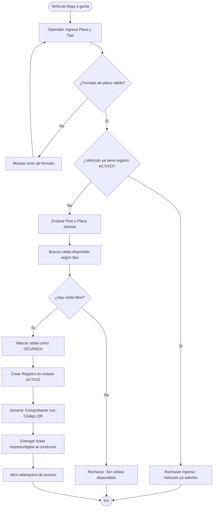
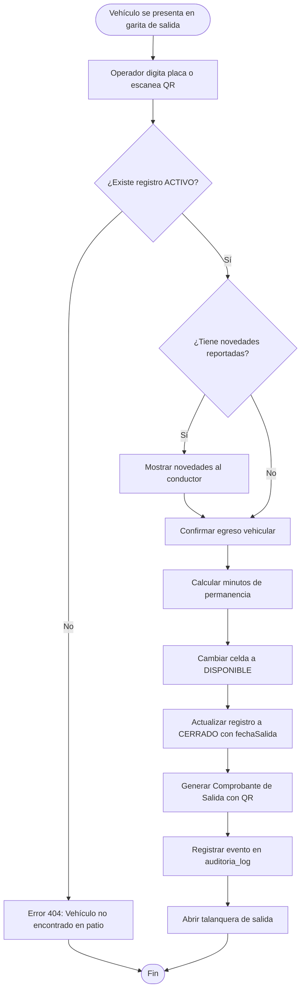

# Requerimientos e Historias de Usuario (RF, RNF y HU)
## Sistema de Información "Autos Colombia" – Iteración 1
**Actividad:** S20 - Evidencia de Aprendizaje 1. Diseño Sistema de Información – Iteración 1  
**Institución:** Institución Universitaria Digital de Antioquia (IU Digital)  
**Asignatura:** Ingeniería de Software  
**Grupo:** [PREICA2602B020081](https://iudigital.instructure.com/courses/28333)  
**Profesor:** Esteban Montoya Molina  
**Roles asumidos:** Analista de Requerimientos, Desarrollador Backend y Desarrollador Frontend / QA (modalidad individual)
**Estudiante:** Brayan Alejandro Durango Urrea
**Fecha y Ubicación:** Octubre 2026, Medellín, Antioquia, Colombia  

---

## 1. Requerimientos Funcionales (RF) – Iteración 1 (Entrada y Salida)

| Código | Nombre del Requerimiento | Actor | Descripción Detallada | Criterio de Éxito / Regla de Negocio |
|---|---|---|---|---|
| **RF-01** | Autenticación y Control de Acceso | Operador, Admin | El sistema debe permitir a los usuarios identificarse con correo electrónico y contraseña encriptada, generando un token JWT para la sesión. | Token JWT válido por 8 horas emitido. Bloqueo de cuenta tras 3 intentos fallidos por 15 minutos. |
| **RF-02** | Registro de Entrada Vehicular | Operador | El sistema debe capturar la placa, tipo, marca, modelo, color y datos del propietario (opcional) al ingresar un vehículo a las instalaciones. | Formato de placa validado (colombiano: `ABC123` o `AB123C`). Creación de registro en estado `ACTIVO`. |
| **RF-03** | Validación de Pico y Placa | Sistema | El sistema debe verificar si la placa estaría restringida según las reglas implementadas para días hábiles en Bogotá D.C. | Verifica el último carácter de la placa según día de la semana. El comportamiento real actual rechaza la entrada si está restringida; no es solo una alerta. |
| **RF-04** | Asignación Automática de Celda | Sistema | El sistema debe buscar la primera celda disponible adecuada para la tipología del vehículo (`CARRO`, `MOTO`, `CAMIONETA`) y asignarla durante la transacción de entrada. | La celda pasa a estado `OCUPADA`. Si no hay celdas disponibles, rechaza el ingreso con error descriptivo. El bloqueo atómico frente a múltiples admisiones simultáneas debe reforzarse y probarse antes de prometer exclusión de carreras. |
| **RF-05** | Emisión de Comprobante de Entrada (QR) | Sistema | El sistema genera el comprobante y código QR con el servicio de entrada. | La entrada retorna el DTO de registro; el frontend consulta después `GET /api/v1/comprobantes?registroId={id}` para leer el QR. |
| **RF-06** | Registro de Salida Vehicular | Operador | El sistema permite cerrar la estancia activa, identificada por placa. | El registro pasa de `ACTIVO` a `CERRADO`; la duración se expresa en minutos. |
| **RF-07** | Liberación Automática de Celda | Sistema | Al confirmarse la salida del vehículo, el sistema debe cambiar el estado de la celda asociada para que vuelva a estar libre. | La celda pasa inmediatamente a estado `DISPONIBLE` para recibir nuevos vehículos. |
| **RF-08** | Emisión de Comprobante de Salida (QR) | Sistema | El sistema genera un comprobante al completar la salida. | Verificar y documentar el DTO/consulta de salida antes de prometer entrega del QR de salida: la API de salida devuelve un `RegistroDTO`, no el comprobante. |
| **RF-09** | Consulta y Búsqueda de Vehículos | Operador, Admin | El sistema debe permitir consultar vehículos registrados filtrando por placa, nombre o documento del propietario y tipo de vehículo. | Retorna coincidencias parciales o exactas con paginación y ordenamiento. |
| **RF-10** | Registro y Gestión de Novedades | Operador | El sistema debe permitir reportar daños, rayones, fugas mecánicas u objetos dejados en el vehículo durante su estancia. | Novedad tipificada (`RAYON`, `DANO_MECANICO`, etc.), con descripción obligatoria y URL de soporte fotográfico. |
| **RF-11** | Cancelación de Registro Erróneo | Operador, Admin | El sistema debe permitir anular un registro activo en caso de equivocación de placa o cancelación inmediata del servicio. | El registro pasa a `CANCELADO`, la celda se libera a `DISPONIBLE` y se registra el motivo de anulación. |
| **RF-12** | Dashboard Operativo en Tiempo Real | Admin, Operador | El sistema debe consolidar las métricas de capacidad: total celdas, celdas disponibles, celdas ocupadas y porcentaje de ocupación global y por tipo. | Indicadores calculados al instante mediante consultas optimizadas a base de datos. |
| **RF-13** | Exportación de Reporte de Ocupación | Administrador | El sistema debe generar y descargar un archivo en formato plano CSV con el historial de vehículos atendidos y tiempos de permanencia. | Archivo CSV estructurado con cabeceras y codificación UTF-8 compatible con Microsoft Excel. |
| **RF-14** | Trazabilidad y Auditoría Transversal | Sistema | El sistema debe registrar cada operación sensible (login, entrada, salida, cancelación, novedad) con IP, usuario, timestamp y resultado. | Registros inmutables en la tabla `auditoria_log` para supervisión operativa y de seguridad. |

---

## 2. Requerimientos No Funcionales (RNF)

| Código | Categoría | Requerimiento No Funcional | Métrica / Estándar de Conformidad |
|---|---|---|---|
| **RNF-01** | **Seguridad** | Cifrado criptográfico de contraseñas de usuarios. | Algoritmo BCrypt con factor de costo 10. Prohibido texto plano. |
| **RNF-02** | **Seguridad** | Autenticación basada en tokens sin estado (stateless). | Tokens JWT firmados con algoritmo HMAC-SHA256, expiración a 8 horas. |
| **RNF-03** | **Seguridad** | Autorización y control de acceso basado en roles (RBAC). | Roles `ADMINISTRADOR` y `OPERADOR` validados en cada endpoint con Spring Security. |
| **RNF-04** | **Rendimiento** | Tiempo de respuesta en operaciones transaccionales de garita. | Menor a 500 ms en el percentil 95 ($P_{95}$) para registrar entrada o salida. |
| **RNF-05** | **Concurrencia** | Manejo de transacciones atómicas y prevención de condiciones de carrera. | Transacciones `@Transactional` en aislamiento por defecto y bloqueo en asignación de celdas. |
| **RNF-06** | **Disponibilidad** | Persistencia relacional ACID y recuperación ante fallos. | PostgreSQL con transacciones seguras y volumen Docker persistente. |
| **RNF-07** | **Mantenibilidad** | Código fuente modular, desacoplado y arquitectura en capas. | Principios SOLID, separación estricta en 4 capas (Presentación, Dominio, Infraestructura, Datos). |
| **RNF-08** | **Portabilidad** | Despliegue agnóstico del sistema operativo subyacente. | Contenedorización mediante Docker y Docker Compose (Java 17 OpenJDK + PostgreSQL 16). |
| **RNF-09** | **Calidad de Código** | Pruebas automatizadas de cobertura y regresión. | Cobertura de líneas ≥ 70% medida con JaCoCo; resultado local: 90,2%. |
| **RNF-10** | **Usabilidad** | Diseño de interfaces ágil y optimizado para garita de parqueo. | Registro de entrada completable en menos de 3 clics y 10 segundos por vehículo. |

---

## 3. Historias de Usuario (HU) Asociadas

### HU-01: Autenticación de Operador y Administrador
* **ID:** `HU-01` | **Requerimiento Asociado:** `RF-01` | **Prioridad:** Alta  
* **Como:** Operador o Administrador del parqueadero  
* **Quiero:** Iniciar sesión con mi correo corporativo y contraseña en la plataforma  
* **Para:** Acceder a las funciones de control de parqueo correspondientes a mi rol con seguridad  
* **Criterios de Aceptación:**
  * **Dado** que ingreso credenciales registradas y correctas, **cuando** presiono "Ingresar", **entonces** el sistema me otorga un token JWT y me redirige al Dashboard principal.
  * **Dado** que ingreso una contraseña incorrecta, **cuando** intento acceder, **entonces** el sistema rechaza el intento con código 401 y aumenta el contador de fallos.
  * **Dado** que se acumulan 3 intentos fallidos consecutivos en la misma cuenta, **cuando** se intenta un cuarto acceso, **entonces** la cuenta se bloquea por 15 minutos.

---

### HU-02: Registro de Entrada Vehicular y Asignación de Celda
* **ID:** `HU-02` | **Requerimiento Asociado:** `RF-02`, `RF-04` | **Prioridad:** Alta  
* **Como:** Operador de garita  
* **Quiero:** Digitar la placa y características de un vehículo que llega a la entrada  
* **Para:** Registrar formalmente su ingreso y asignarle automáticamente una celda libre  
* **Criterios de Aceptación:**
  * **Dado** que el vehículo no está dentro del parqueadero, **cuando** el operador ingresa la placa válida y el tipo de vehículo, **entonces** el sistema busca la primera celda libre de esa tipología, cambia la celda a `OCUPADA` y crea un registro `ACTIVO`.
  * **Dado** que el vehículo ya tiene una entrada activa sin salida registrada, **cuando** se intenta registrar de nuevo, **entonces** el sistema bloquea la operación con un error 409 Conflict.
  * **Dado** que no hay celdas libres para ese tipo de vehículo, **cuando** se solicita el ingreso, **entonces** el sistema emite un aviso de "No hay celdas disponibles para esta categoría".

---

### HU-03: Validación Automática de Pico y Placa
* **ID:** `HU-03` | **Requerimiento Asociado:** `RF-03` | **Prioridad:** Media-Alta  
* **Como:** Operador de parqueadero  
* **Quiero:** Que el sistema verifique si la placa ingresada tiene restricción de Pico y Placa en Bogotá  
* **Para:** Advertir al usuario o cumplir con las políticas de control vial antes de admitirlo  
* **Criterios de Aceptación:**
  * **Dado** un día lunes y una placa terminada en 6 o 9, **cuando** se intenta registrar la entrada, **entonces** el servicio actual rechaza la operación con una regla de negocio (HTTP 400); cambiarlo a advertencia no bloqueante requiere una modificación posterior.
  * **Dado** un día sábado, domingo o festivo, **cuando** ingresa cualquier vehículo, **entonces** el sistema certifica que no aplica restricción.

---

### HU-04: Emisión de Comprobante de Entrada con Código QR
* **ID:** `HU-04` | **Requerimiento Asociado:** `RF-05` | **Prioridad:** Alta  
* **Como:** Conductor / Usuario del parqueadero  
* **Quiero:** Recibir un ticket impreso o digital con los datos de mi estancia y un código QR  
* **Para:** Tener soporte de recepción de mi vehículo y facilitar mi salida ágil  
* **Criterios de Aceptación:**
  * **Dado** un registro de entrada exitoso, **cuando** se confirma la transacción, **entonces** el backend guarda un comprobante con código y QR Base64.
  * **Dado** el registro creado, **cuando** el cliente consulta `GET /api/v1/comprobantes?registroId={id}`, **entonces** recibe el comprobante que contiene el QR. La lectura óptica del QR debe probarse por separado.

---

### HU-05: Registro de Salida y Liberación de Celda
* **ID:** `HU-05` | **Requerimiento Asociado:** `RF-06`, `RF-07`, `RF-08` | **Prioridad:** Alta  
* **Como:** Operador de garita  
* **Quiero:** Buscar la placa de un vehículo que se retira del parqueadero y confirmar su salida  
* **Para:** Cerrar la estancia, liquidar los minutos de permanencia y liberar la celda para otro cliente  
* **Criterios de Aceptación:**
  * **Dado** un vehículo con registro activo, **cuando** el operador busca su placa y confirma la salida, **entonces** el registro pasa a estado `CERRADO`, la celda asignada pasa inmediatamente a `DISPONIBLE` y se calcula la duración exacta.
  * **Dado** una placa que no tiene estancia activa, **cuando** se intenta registrar la salida, **entonces** el sistema informa un error 404 de "Registro no encontrado".
  * **Dado** el cierre de estancia, **cuando** finaliza la transacción, **entonces** se genera el comprobante de salida correspondiente.

---

### HU-06: Registro de Novedades e Incidentes en Vehículos
* **ID:** `HU-06` | **Requerimiento Asociado:** `RF-10` | **Prioridad:** Media  
* **Como:** Operador de garita o supervisor  
* **Quiero:** Registrar cualquier daño, golpe o eventualidad ocurrida a un vehículo estacionado  
* **Para:** Dejar constancia legal y pericial respaldada con descripción y fotos  
* **Criterios de Aceptación:**
  * **Dado** un registro activo, **cuando** el operador detecta un daño (rayón, golpe), **entonces** diligencia el formulario con el tipo de novedad, descripción y enlace a foto de evidencia.
  * **Dado** el envío del formulario, **cuando** se procesa la solicitud, **entonces** la novedad queda permanentemente ligada al registro y se audita al usuario que la reportó.

---

### HU-07: Monitoreo de Celdas y Ocupación en Dashboard
* **ID:** `HU-07` | **Requerimiento Asociado:** `RF-12` | **Prioridad:** Media  
* **Como:** Administrador o Jefe de Patio  
* **Quiero:** Visualizar en un panel central los porcentajes de ocupación y celdas libres por piso y tipo  
* **Para:** Tomar decisiones sobre el flujo de vehículos y optimizar la capacidad instalada  
* **Criterios de Aceptación:**
  * **Dado** el ingreso al sistema, **cuando** se carga el Dashboard, **entonces** se presentan tarjetas con el total de celdas, celdas ocupadas, celdas disponibles y barras de progreso por tipo (`CARRO`, `MOTO`, `CAMIONETA`).
  * **Dado** el ingreso o salida de un vehículo en garita, **cuando** se consulta el Dashboard, **entonces** las cifras reflejan el cambio en tiempo real.

---

### HU-08: Exportación de Reportes Operacionales en Formato CSV
* **ID:** `HU-08` | **Requerimiento Asociado:** `RF-13` | **Prioridad:** Media  
* **Como:** Administrador del parqueadero  
* **Quiero:** Descargar un reporte consolidado de ocupación y estancias en archivo CSV  
* **Para:** Analizar las horas pico, calcular ingresos potenciales y realizar conciliaciones contables en Excel  
* **Criterios de Aceptación:**
  * **Dado** un usuario con rol `ADMINISTRADOR`, **cuando** solicita la exportación a través de `/api/v1/reportes/ocupacion`, **entonces** el sistema genera un archivo `reporte_ocupacion.csv` con cabeceras formateadas y registros ordenados cronológicamente.
  * **Dado** un usuario con rol `OPERADOR`, **cuando** intenta descargar el reporte, **entonces** el sistema restringe el acceso con un error 403 Forbidden.

---

## 4. Reglas de Negocio Oficiales (RN)

| Código | Nombre de la Regla | Descripción y Restricción Lógica |
|---|---|---|
| **RN-01** | Formato de Placas Vehiculares | La placa debe cumplir con el formato oficial del Ministerio de Transporte de Colombia: 3 letras y 3 números para automóviles particulares/comerciales (`^[A-Z]{3}[0-9]{3}$`), o 3 letras, 2 números y 1 letra para motocicletas (`^[A-Z]{3}[0-9]{2}[A-Z]$`). Las letras siempre se almacenan en mayúsculas sin guiones ni espacios. |
| **RN-02** | Política Distrital de Pico y Placa | La restricción vehicular aplica en días hábiles (lunes a viernes de 6:00 a.m. a 9:00 p.m.). En días pares tienen restricción las placas terminadas en números pares (0, 2, 4, 6, 8) y en días impares las terminadas en números impares (1, 3, 5, 7, 9). Si el vehículo ingresa con restricción, el sistema no bloquea el parqueo pero emite una alerta visual y registra la advertencia en el ticket. |
| **RN-03** | Asignación de Celdas por Tipología | Un vehículo solo puede ocupar una celda que coincida con su tipo (`CARRO` en celda `CARRO`, `MOTO` en celda `MOTO`, `CAMIONETA` en celda `CAMIONETA`). La asignación se realiza mediante búsqueda atómica de la celda de menor identificador disponible. |
| **RN-04** | Exclusividad de Estancia Activa | Un vehículo no puede tener más de un registro en estado `ACTIVO` simultáneamente. Si una placa ya se encuentra dentro de las instalaciones, se rechaza cualquier nuevo intento de admisión con código HTTP 409 Conflict. |
| **RN-05** | Cálculo del Tiempo de Permanencia | El tiempo de permanencia se calcula como la diferencia en minutos entre la `fechaSalida` y la `fechaEntrada`. Si la permanencia es menor a 1 minuto, se liquida como 1 minuto mínimo. |
| **RN-06** | Registro Inmutable de Auditoría | Toda acción de creación de registros, cierre de estancia, reporte de novedades y cancelación debe generar un registro automático e inalterable en `auditoria_log` con el usuario autenticado, IP del cliente, timestamp y detalles. |

---

## 5. Diagramas de Flujo de Procesos de Negocio

### 5.1 Flujo Operativo de Registro de Entrada

### 5.2 Flujo Operativo de Registro de Salida

---

## 6. Matriz de Trazabilidad (RF vs HU vs Criterios de Aceptación)

| Requerimiento Funcional | Historia de Usuario | Criterios de Aceptación (Gherkin) | Regla de Negocio |
|---|---|---|---|
| **RF-01: Autenticación** | `HU-01` | Credenciales válidas -> Token JWT emitido (8h) Contraseña errónea -> 401 Unauthorized 3 fallos consecutivos -> Bloqueo temporal | RN-06 |
| **RF-02: Registro Entrada** | `HU-02` | Placa válida + no activa -> Registro ACTIVO creado Placa ya dentro -> 409 Conflict | RN-01, RN-04 |
| **RF-03: Pico y Placa** | `HU-03` | Lunes placa 6 o 9 -> Entrada rechazada HTTP 400 Sábados/Domingos -> Sin restricción | RN-02 |
| **RF-04: Asignación Celda** | `HU-02` | Celda libre de su tipología -> Asignada y OCUPADA Sin celdas libres -> Rechazo con 400 Bad Request | RN-03 |
| **RF-05: Ticket QR Entrada** | `HU-04` | Entrada exitosa -> Consultar comprobante con `GET /api/v1/comprobantes?registroId={id}` | RN-06 |
| **RF-06: Registro Salida** | `HU-05` | Registro ACTIVO -> Registro pasa a CERRADO Placa no encontrada -> 404 Not Found | RN-05 |
| **RF-07: Liberación Celda** | `HU-05` | Confirmación de salida -> Celda pasa a DISPONIBLE | RN-03 |
| **RF-08: Ticket QR Salida** | `HU-05` | La API de salida devuelve `RegistroDTO`; confirmar por separado endpoint/flujo para consultar comprobante tipo SALIDA | RN-05, RN-06 |
| **RF-09: Búsqueda Vehículos** | `HU-02`, `HU-05` | Filtro por placa, tipo o propietario -> Resultados paginados | RN-01 |
| **RF-10: Novedades** | `HU-06` | Detección de daño -> Formulario con tipo, descripción y foto | RN-06 |
| **RF-11: Cancelación Registro**| `HU-02` | Registro erróneo -> Anulado a CANCELADO, celda liberada | RN-03, RN-06 |
| **RF-12: Dashboard Celdas** | `HU-07` | Carga de panel -> Indicadores y métricas en tiempo real | RN-03 |
| **RF-13: Reporte CSV** | `HU-08` | Rol Admin -> Descarga archivo CSV estructurado Rol Operador -> 403 Forbidden | RN-06 |
| **RF-14: Auditoría** | `HU-01` a `HU-08`| Operaciones críticas registradas en `auditoria_log` | RN-06 |

---

**Fin de la especificación funcional y matriz de trazabilidad.**

---

