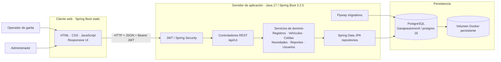
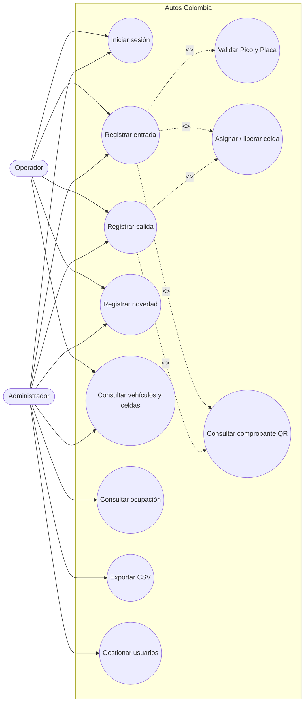
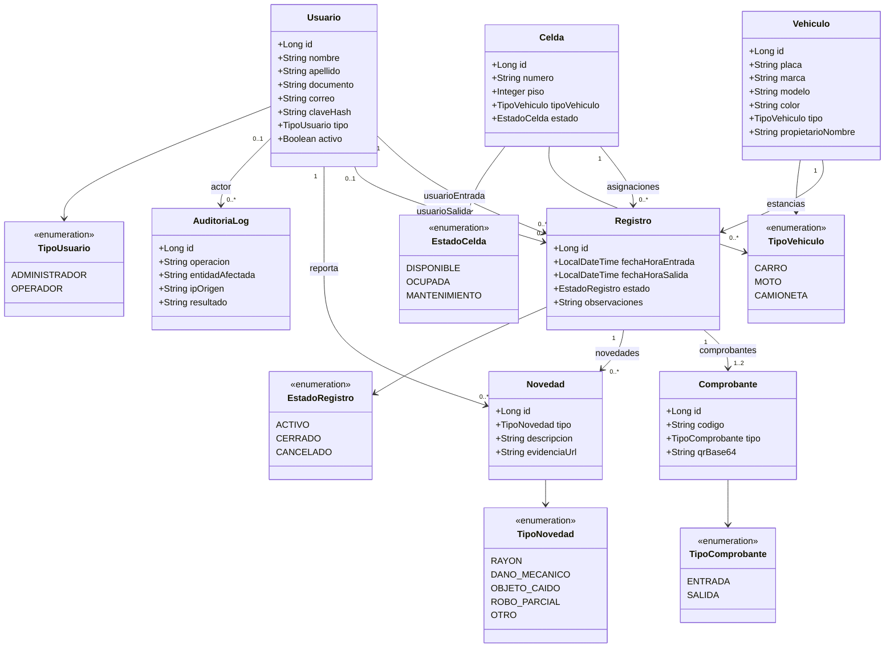
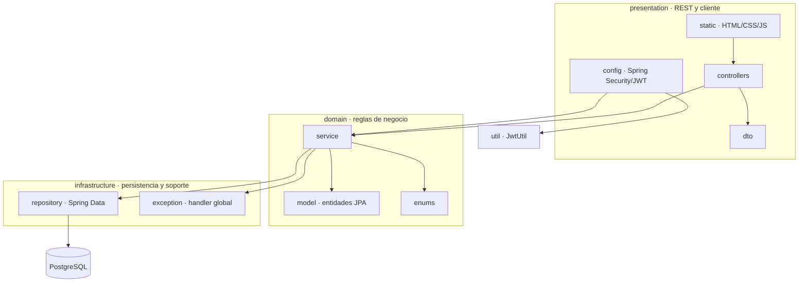

# Autos Colombia — Entregables visuales de Iteración 1

**Estudiante:** Brayan Alejandro Durango Urrea · **Modalidad:** individual · **Fecha:** octubre de 2026
**Fuente editable de los diagramas:** Mermaid en este documento; **mockups:** HTML/CSS servidos por Spring Boot en `src/main/resources/static/`.

> Estos diagramas están renderizados por GitHub al visualizar este Markdown. Son evidencia visual versionada, además del modelo semántico `.mdj`; no son capturas/exportaciones de StarUML ni un archivo de Figma. No se afirma que existe un documento Figma cuando no se ha creado en la cuenta del estudiante.

---

## 1. Arquitectura de la aplicación

## 2. Casos de uso de la Iteración 1

### Flujo funcional verificado

- La API bloquea una entrada cuando el cálculo de Pico y Placa devuelve restricción (no es una simple advertencia). El rango horario/festivos no está configurado en la regla actual.
- Al confirmar entrada, se genera comprobante persistido con QR. El cliente consulta `GET /api/v1/comprobantes?registroId={id}` para visualizarlo.
- El egreso cierra el registro y libera la celda; la API de egreso devuelve `RegistroDTO`, no el QR. El flujo de QR de salida requiere verificación adicional.
- El CSV existe, pero en la configuración actual su endpoint requiere autenticación general y aún no tiene `ADMINISTRADOR` aplicado de forma explícita.

## 3. Diagrama de clases del dominio

## 4. Diagrama de paquetes

## 5. Mockups

Los mockups de fidelidad de implementación son accesibles desde la propia aplicación, en la raíz del servidor Spring Boot (`http://localhost:8080`):

1. **Acceso:** correo, contraseña, estado de error y sesión.
2. **Dashboard:** KPIs, ocupación y últimos registros.
3. **Entrada:** placa, tipo, datos opcionales del propietario, respuesta de asignación y QR cuando está disponible.
4. **Salida:** consulta por placa, resumen, observaciones, cierre de estancia.
5. **Novedades:** registro de incidencia por estancia activa.

La vista HTML incluye estilos responsive y controles conectados con la API. No debe llamarse «prototipo Figma»: la evidencia de la interfaz implementada es el frontend del repositorio. Para ver las pantallas, levanta la aplicación; para ver inmediatamente los diagramas, abre la pestaña **Preview** de este Markdown o la página del repositorio en GitHub.

**Verificación local reciente:** `mvn clean verify` · 136 pruebas Java · 0 fallos · 0 errores · 0 omitidas · JaCoCo líneas 90,2%. Pruebas de humo frontend: 4/4.
